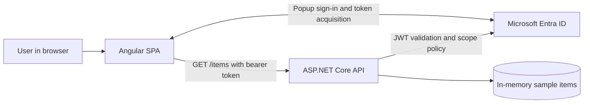
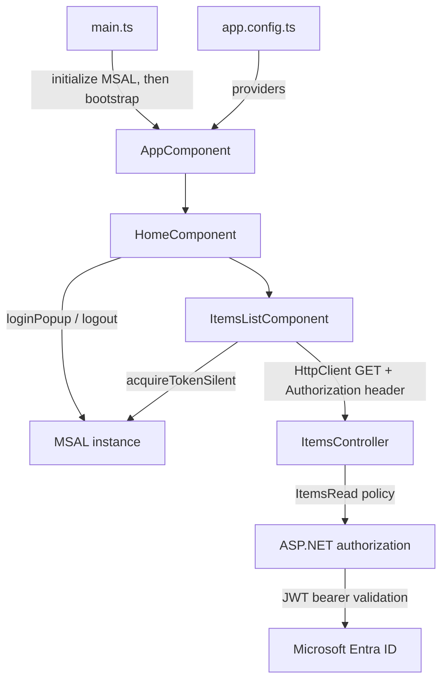
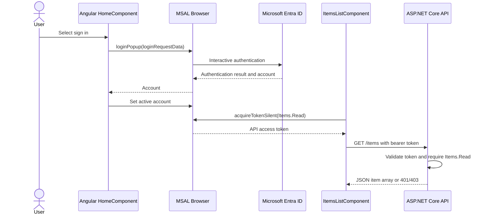

# Project Architecture Blueprint

Generated: 2026-11-13  
Scope: `auth-client-app` (Angular) and `auth-api-app` (ASP.NET Core)

## 1. Architecture Detection

| Area | Detected implementation |
|---|---|
| Frontend | Angular 19 standalone components, TypeScript 5.7, RxJS, MSAL Angular/Browser, Bootstrap 5 |
| Backend | ASP.NET Core Web API on .NET 9, controller-based endpoints, Microsoft.Identity.Web and JWT bearer authentication |
| Architecture | Small two-tier client/API application; component-oriented UI with a single API controller. It is not Clean Architecture, microservices, or a separately layered domain application. |
| Persistence | None. The API's sample items are held in a controller field in memory. |
| Runtime integration | Browser-to-API HTTP/HTTPS; browser-to-Microsoft Entra ID for sign-in and token acquisition |

This document describes code and configuration present in the repository. The README contains older directory names and setup wording; the actual project directories are `auth-client-app` and `auth-api-app`.

## 2. Architectural Overview

The Angular application bootstraps only after the MSAL browser client initializes. The root component renders the home component, which handles popup sign-in and sign-out. The items-list component checks for an active account, obtains an API access token silently, and makes a bearer-authenticated HTTP GET. The API validates bearer tokens through Microsoft.Identity.Web and protects the items endpoint with a policy requiring the `Items.Read` scope.

The strongest boundary is the API authorization policy. Frontend visibility and account checks are user-experience behavior, not the security boundary. The backend currently combines HTTP handling and sample data ownership in one controller; there are no application/domain/data-access layers or persistence abstractions.

### Context and container view



### Main component dependencies



### Sign-in and protected request flow



## 3. Core Components

| Component | Responsibility and boundaries | Extension approach |
|---|---|---|
| `main.ts` / `app.config.ts` | Initialize MSAL, bootstrap Angular, register HTTP client and MSAL providers, provide routes (currently empty). | Keep startup and global providers here; add global interceptors or guards only when adopting those patterns consistently. |
| `AppComponent` | Root shell; imports and displays `HomeComponent`. `RouterOutlet` exists, but no routes are configured. | Add routed screens through `app.routes.ts`, or keep the current shell composition for a small single-view app. |
| `HomeComponent` | Owns popup login/logout interactions and active-account signal; composes the items list. | Keep identity UI state here or move shared auth state into an injectable service if more components need it. |
| `ItemsListComponentComponent` | Acquires an API token, calls the items endpoint, and stores the result in an Angular signal. | Move endpoint/token orchestration into an API/auth service if additional endpoints or consumers are added. |
| `Program.cs` | Configures CORS, OpenAPI in Development, controllers, JWT bearer authentication, authorization policy, and middleware ordering. | Register policies and middleware centrally; keep endpoint-specific requirements declarative. |
| `ItemsController` | Exposes `GET /items`, requires `ItemsRead`, and returns a fixed in-memory list. | Extract storage/business logic to services and a repository only when persistence or reusable domain behavior is introduced. |
| `Item` | Simple data-transfer/domain-shaped object with integer `Id` and string `Name`; no business behavior. | Add validation or richer domain types when real input or business rules exist. |

There is no event bus, background worker, plugin system, repository abstraction, or service discovery mechanism in the inspected implementation.

## 4. Layers and Dependency Rules

The code currently has two deployable application parts and framework-level internal layers:

1. **Angular presentation/startup:** standalone components, application providers, and a currently empty router configuration.
2. **HTTP API:** ASP.NET Core middleware, controllers, authorization, and response serialization.
3. **Sample data:** a controller-owned in-memory list; it is not an independent data layer.
4. **External identity:** Microsoft Entra ID, reached by MSAL in the browser and used as the token issuer trusted by the API.

Dependencies point from UI components to MSAL/Angular APIs and from the API host/controller to ASP.NET Core and Microsoft.Identity.Web. No explicit project-level dependency rules or architecture tests enforce separation. No circular project dependencies were found in this small structure.

## 5. Data Architecture

- The API returns a fixed list of four `Item` objects. It is recreated with the controller and is not durable or shared across processes.
- There are no database packages, migrations, repositories, ORM configuration, cache, or transaction boundaries.
- API JSON is consumed as `Item[]` by the Angular client; the frontend model has `id` and `name` fields.
- No explicit input validation is needed for the current read-only endpoint. No DTO mapping layer or business-rule validation is present.
- Adding mutations or durable data should introduce request/response DTOs, validation, an application service, and a persistence boundary appropriate to the chosen store; do not imply those abstractions already exist.

## 6. Authentication, Authorization, and Cross-Cutting Concerns

### Authentication and authorization

- The browser uses `@azure/msal-browser` through `@azure/msal-angular`. The MSAL instance is initialized before Angular bootstraps.
- Sign-in uses a popup request; the home component sets the returned account as active. Sign-out calls MSAL logout and clears the active account.
- The items component silently requests the API scope and manually attaches the returned access token as an `Authorization: Bearer` header.
- The API registers JWT bearer authentication using Microsoft.Identity.Web and an `ItemsRead` policy requiring the `Items.Read` scope. `ItemsController.List` is protected by that policy.
- The API is the effective authorization boundary. The Angular app currently has no configured route guard, and the router has no routes. `MsalGuard` is provided but not applied to any route.
- MSAL uses browser local storage as its cache. This is a material browser security choice: an XSS issue can expose tokens available to page scripts.
- The items component logs the acquired access token to the browser console. Remove this before using real accounts or production data.
- Configuration contains tenant/app registration values in source/config files. These identifiers are not secrets, but environment-specific values should be externalized for maintainability. No client secret is needed in the SPA.

### CORS and transport

- The API permits the Angular development origin `http://localhost:4200`, all headers/methods, and credentials.
- The API enables HTTPS redirection and launch settings define local HTTP and HTTPS endpoints. The Angular items URL currently points to `http://localhost:5174/items`; verify browser behavior against the HTTPS redirect and local certificate, and use one intentional local API base URL.
- For deployment, replace the localhost origin and API URL with environment-specific values and use HTTPS. Do not broaden CORS to arbitrary origins when credentials are enabled.

### Errors, resilience, logging, and validation

- There is no custom API exception handling, retry, circuit breaker, fallback, or structured application telemetry code evident.
- ASP.NET Core logging levels are configured in appsettings. The Angular startup and item flow use console logging; the access-token log is sensitive and should be removed.
- Framework behavior supplies standard HTTP/authentication responses. The client does not show explicit loading, token-acquisition error, API error, or retry handling in the inspected component.
- No feature flags, centralized secret store, or custom configuration validation are present.

## 7. Service Communication

Communication is synchronous HTTP/JSON: the SPA calls `GET /items` with a bearer access token. Authentication and API token acquisition involve MSAL and Microsoft Entra ID. There is no asynchronous messaging, API versioning, service discovery, or inter-service communication. The endpoint route is derived from the controller name (`/items`); no version prefix is configured.

The current frontend URL and backend launch settings are local-development values. Promote them to environment-specific configuration before deploying multiple environments. Keep scope names and API registration settings aligned between the SPA request and API policy.

## 8. Technology-Specific Patterns

### Angular

- Standalone bootstrap uses `bootstrapApplication`; components use standalone imports and Angular dependency injection via `inject`.
- Local component state uses signals. HTTP requests use `HttpClient`, converted to promises with RxJS `firstValueFrom` in the items component.
- MSAL services and instance are registered in application providers. No global MSAL HTTP interceptor, NgRx store, resolver, or configured route guard is present.
- The UI is organized by feature/component folders, but the project is small and not organized into formal domain or data-access libraries.

### ASP.NET Core

- The .NET 9 web SDK hosts a controller-based API. Services are registered in `Program.cs` using the built-in dependency injection container.
- Middleware order is CORS, HTTPS redirection, authentication, and authorization, followed by controller mapping. Authentication precedes authorization.
- OpenAPI is mapped only in the Development environment. There is no ORM or other persistence integration.

## 9. Representative Implementation Patterns

The following snippets summarize existing behavior; they omit registration identifiers and environment-specific values.

### API authorization policy and endpoint

```csharp
builder.Services.AddAuthorization(options =>
{
    options.AddPolicy("ItemsRead", policy =>
        policy.RequireScope("Items.Read"));
});

[Authorize(policy: "ItemsRead")]
[HttpGet]
public ActionResult<List<Item>> List() => Items;
```

### Client token acquisition and API request

```typescript
const token = await msal.instance.acquireTokenSilent(loginRequestItemsData);
const items = await firstValueFrom(
  httpClient.get<Item[]>(itemsUrl, {
    headers: { Authorization: `Bearer ${token.accessToken}` },
  }),
);
```

Do not log `token.accessToken`. For additional endpoints, prefer a focused API client service and a deliberate token attachment strategy over duplicating request logic across components.

## 10. Testing Architecture

- Angular uses Karma/Jasmine and has basic component-creation specs for the root, home, and items-list components.
- The root spec still expects an older generated greeting (`Hello, auth-client-app`) that does not match the current root template. Treat the existing specs as scaffolding until aligned with current behavior.
- No API test project or integration tests were found. There are no demonstrated test doubles for MSAL or HTTP in the listed specs.
- Recommended coverage: auth state and popup actions in `HomeComponent`; silent token acquisition and HTTP request/error behavior in the list component; API success, missing/invalid token, missing scope, and CORS behavior using ASP.NET integration tests.
- Keep tests at the owning boundary: component tests for UI state, service tests for API orchestration if extracted, and API integration tests for middleware/policy behavior.

## 11. Deployment Architecture

Repository configuration describes local development, not a production topology:

- Angular is built by Angular CLI to `dist/auth-client-app`; production build uses output hashing and bundle/style budgets.
- ASP.NET Core runs from `auth-api-app`, targets `net9.0`, and has local launch profiles on ports 5174 (HTTP) and 7193 (HTTPS).
- OpenAPI is development-only. No Dockerfile, compose file, CI workflow, Bicep/Terraform, hosting configuration, or deployment automation was found.
- The API's in-memory items are process-local and reset on restart. A production deployment with multiple instances would not provide durable or shared data.
- Configure app registrations, redirect URIs, allowed CORS origins, API base URL, tenant settings, and HTTPS per environment. Avoid committing secrets; no server-side secret is required for the demonstrated SPA flow.

## 12. Architectural Decisions and Constraints

The repository does not include formal ADRs. The following are observable choices, not claims about undocumented intent:

| Observed choice | Evidence and consequence |
|---|---|
| Separate SPA and API | Independent Angular and ASP.NET projects; supports a browser client calling a protected API, but requires coordinated origins/scopes/configuration. |
| Entra ID access-token security | MSAL obtains an API-scoped token and Microsoft.Identity.Web validates it; access is expressed as a required scope policy. |
| Controller-based API | ASP.NET controller routing and attributes are used; suitable for the current single endpoint, with business/data concerns currently co-located. |
| In-memory sample data | A controller field supplies the items; simple for a demonstration, but non-durable and unsuitable for shared production data. |
| Manual token attachment | The component obtains and attaches a token explicitly; easy to follow for one API call, but duplicates concerns as the API surface grows. |
| Popup flow and local storage | MSAL popup login and local-storage cache are configured; verify these choices against browser policy, threat model, and production UX requirements. |

Alternatives, selection criteria, and historical rationale cannot be established from the code alone.

## 13. Extension Blueprint

### Add a protected API feature

1. Define the response/request contract and add the endpoint in a controller following the existing route conventions.
2. Select or define the API scope and apply an explicit authorization policy to the endpoint.
3. Keep business behavior out of controllers once it is shared or non-trivial; introduce an application service and persistence abstraction only when needed.
4. Add an Angular API client service for URL construction, token acquisition, HTTP calls, and error mapping if multiple components consume the API.
5. Add focused frontend tests and API integration tests, including authorization failure cases.
6. Configure local and deployed origins, redirect URIs, API URLs, and scopes as environment-specific settings.

### Add a frontend view

1. Add a standalone component under the relevant feature folder.
2. Compose it from `AppComponent` for the current single-view shell, or register a route in `app.routes.ts` if navigation is introduced.
3. Protect routes with an explicitly configured guard if appropriate, while retaining API-side authorization as the actual data boundary.
4. Add component tests for rendered state and user actions; mock MSAL and HTTP at their boundaries.

### Example future API service boundary

```csharp
public interface IItemsService
{
    Task<IReadOnlyList<Item>> ListAsync(CancellationToken cancellationToken);
}
```

Introduce this abstraction when it separates real business or persistence behavior; it is not necessary for the current fixed sample list.

## 14. Governance and Maintenance

- Current consistency mechanisms are framework conventions, TypeScript/.NET compilation, Angular CLI build/test configuration, and ASP.NET middleware/policy configuration.
- No architecture tests, CI checks, ADR directory, or deployment validation was found.
- Update this blueprint when authentication flows, authorization scopes, API boundaries, persistence, deployment topology, or test strategy changes.
- Verify documentation against source and environment configuration during changes; do not copy local identifiers or secrets into architecture documents.

## 15. Current Risks and Follow-Up

1. Remove access-token console logging from the items component.
2. Align the Angular API URL with the API's HTTPS redirection and the selected local/deployed endpoint.
3. Externalize environment-specific URLs and app registration configuration; keep secrets out of source control.
4. Update the stale root-component spec and add meaningful MSAL/HTTP and API authorization tests.
5. Add persistence and operational/deployment configuration only when the application moves beyond its current demonstration scope.